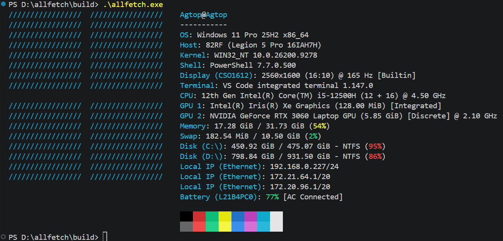
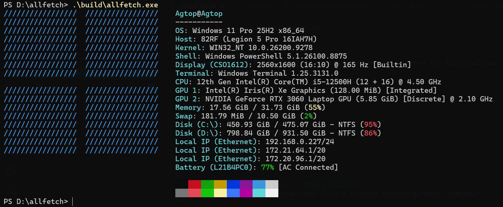
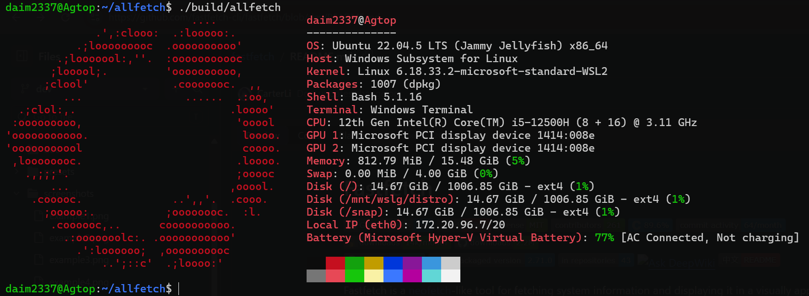
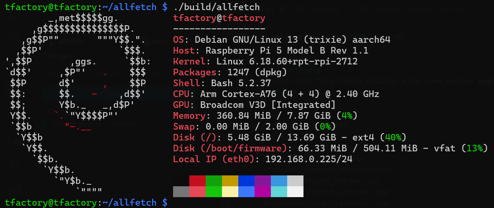

# allfetch

A CLI fetch utility application just like [fastfetch](https://github.com/fastfetch-cli/fastfetch) or [neofetch](https://github.com/dylanaraps/neofetch). It fetches system information and prints it out in a pretty way. It is being tested currently on multiple Linux distros and Windows 11. On linux it supports both aarch64/arm64 and x86_64 architectures.

> Screenshots from a few platforms

## Installation

Currently you can download the desired platform specific version from the [releases](https://github.com/Ag4Hz/allfetch/releases)

> ## Other notes
>
> - AI was used in the implementation process (Codex).
> - I started developing this app as a self-education project
